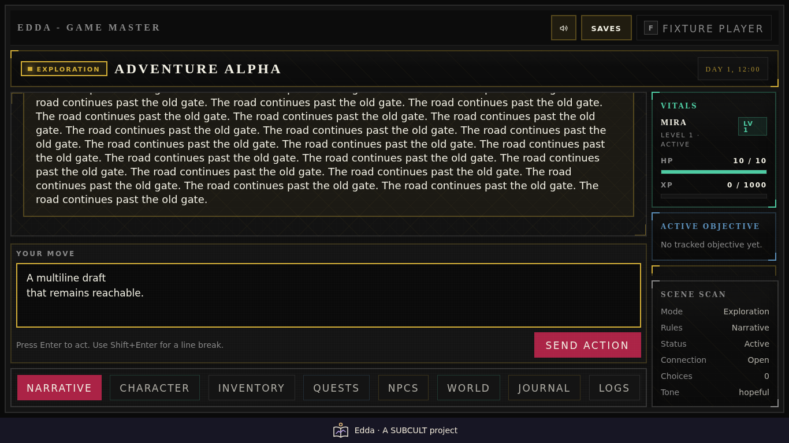
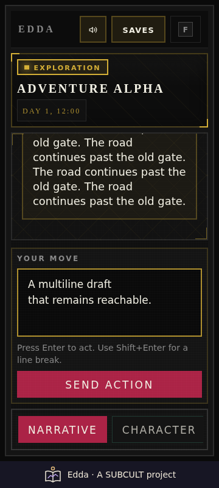

# Viewport shell implementation evidence (#60)

Local fixture qualification on 2026-11-15. This implements the frame portion of
the [#55 decision](../../design/gameplay-concepts.md), informed by #46's
[baseline report](https://github.com/subculture-collective/edda/blob/f0e9f52d673d45a04aef0b5c3db7cfff6526e2a9/docs/playtest/issue-46/README.md).
It does not complete the later composer, context navigation or reader redesign.

## Height and scroll ownership

- The game route gives `body` one visible viewport, with `#root` and the software
  credit as flex siblings. The credit keeps its 44-pixel link target and safe-area
  padding. Other routes keep ordinary document scrolling.
- The application header and campaign banner use their natural height. Header
  controls wrap at increased text size; the redundant “game master” descriptor
  is omitted below `sm`. Header menus anchor inside the frame and scroll when
  needed. No font or button was reduced to make the frame fit.
- The grid gives navigation its own row and the transcript/details the remaining
  space. Navigation scrolls horizontally. The existing context rail is 220 pixels
  at desktop widths; phones/tablets use the existing detail tabs instead of
  placing the whole rail between story and navigation. #71 owns its replacement.
- Transcript history and detail panels scroll internally. Log rows stack on
  phones so timestamps cannot squeeze the text outside the panel. Combat's
  existing view has an internal vertical scroll escape instead of hidden overflow.
- The action form does not shrink. Padding/gaps are reduced, its input is at
  least 17 pixels, and Send/header/navigation controls have at least 44-pixel
  height. Suggested choices get a scroll region capped at `min(10dvh, 8rem)`;
  this is containment for the existing component, not #62's new choice behavior.

The workspace has a 32rem minimum height. When a keyboard-sized viewport or
enlarged text leaves less room, the workspace scrolls inside `.game-app-content`.
This keeps controls reachable without shrinking text or clipping them. The
document and credit stay bounded. A very short viewport therefore requires an
internal scroll to Send; an always-visible composer in every context state is
separate #62 work.

## Phone chrome, keyboard and enlargement strategy

CSS uses `100dvh` as the fallback. The game shell listens to `visualViewport`
resize at scale 1 and budgets its reported height, which covers browsers that
shrink only the visual viewport for the keyboard or browser chrome. The viewport
meta also requests `interactive-widget=resizes-content` in supporting browsers.
Listeners and the inline height override are removed on route exit. Pinch zoom
does not compress the interface into the smaller visual viewport; native panning
remains available. Increased text and reduced CSS viewports can reflow using the
internal-scroll fallback.

The Playwright tests resize the CSS viewport and inject a visual-viewport height;
neither action opens a real software keyboard. Actual Safari/Chrome phone chrome,
keyboard focus/panning, safe-area behavior, pinch zoom, screen readers and normal
software-keyboard reachability still need #46/#78 qualification. No human/device
checkpoint was completed or claimed in Wave 2.

## Deterministic checks

`frontend/tests/browser/viewport.spec.ts` adds nine checks. Before implementation,
all six default-size cases and the long-choice case failed the document-height
contract. After implementation:

| CSS viewport | Long transcript and Logs | Document overflow | Send |
| --- | --- | --- | --- |
| 1366 × 768 | internal vertical scrolling | none | in viewport, at least 44px high |
| 1440 × 900 | internal vertical scrolling | none | in viewport, at least 44px high |
| 1920 × 1080 | internal vertical scrolling | none | in viewport, at least 44px high |
| 768 × 1024 | internal vertical scrolling | none | in viewport, at least 44px high |
| 360 × 800 | internal vertical scrolling | none | in viewport, at least 44px high |
| 390 × 844 | internal vertical scrolling | none | in viewport, at least 44px high |

Both phone widths also pass an eight-long-choice fixture (at least 80px of
transcript remains), 480px reduced height, and 200% root text size. The last
choice, details and Send remain reachable. A synthetic 420px visual viewport
keeps Send within that height after internal scrolling and keeps the credit
visible; SPA navigation restores the ordinary route layout. The audio menu's
horizontal bounds are checked on a phone.

The fixture blocks external services, including the hosted fonts; screenshots
therefore do not qualify font loading or final typography. Existing Marcellus /
Josefin Sans controls, application palette, square borders and existing HUD
effects remain. Georgia story styling/reader refinement remains #90's work.
No new palette, shadow, animation, component kit or dependency was introduced.

Final local validation after merging current `origin/main` (including #100's
required PostgreSQL integration gate):

- `pnpm --dir frontend build`: passed; existing >500kB bundle warning remains.
- `pnpm --dir frontend test`: 10 tests passed. One earlier concurrent run exposed
  the existing PlayerInput test's async-clear timing flake; the next run and
  final merged-tree run passed without changing that test or production behavior.
- `EDDA_FIXTURE_PORT=18460 pnpm --dir frontend test:browser`: all 15 tests passed,
  including the nine new viewport checks and existing auth/play/reconnect tests.
- Scoped ESLint for AppShell, CampaignPlayPage, LogPanel and the new tests: passed.
  Full `pnpm --dir frontend lint`: 23 baseline errors, as recorded in #42/#46.
- `go test -tags integration -run Integration -count=1 -timeout 10m ./...`: passed
  with isolated Testcontainers PostgreSQL, including server, handlers, routing and
  sqlc suites. No application or production DSN was supplied.
- `git diff --check`: passed. Hosted CI remains a separate parent-owned check.

The first hosted run passed 14 browser checks and failed the SPA cleanup check:
the URL had changed before React committed the route and cleaned up its effect.
The original immediate assertion also failed in 2 of 10 local repetitions. The
test now waits for the Campaigns page and the cleanup, then dispatches another
resize to prove the old listener cannot restore the override. All 10 focused
repetitions, all 15 browser checks, 10 unit tests, the frontend build and scoped
ESLint passed after this test correction. No production lifecycle code changed.

Review identified a separate short-height case with the Saves list expanded.
The added fixture loads 20 checkpoints and eight long choices at both 360×480
and 390×480. Before the follow-up fix, both cases collapsed the transcript to
32 pixels and left overflowing content inside a hidden narrative container.
The narrative container now allows vertical scrolling and the transcript keeps
a 6rem minimum height. This provides a scroll escape to the composer instead of
shrinking its controls. The same fixtures then check enlarged text with Saves
still open. They save an `expanded-saves-viewport.png` artifact for inspection.

## Inspected renders

These images come from the isolated long-history fixture, after internally
scrolling to the bottom and filling a multiline draft. They are local evidence,
not production screenshots. The screenshots were visually inspected; control
reachability is established by the assertions above.

## Bounded handoff

#62 owns persistent drafts and the deliberate choice/composer interaction.
#71 owns Character/World/Journal context navigation. #90 owns Georgia story
reading, transcript styling and reading-position retention. #78 owns broader
viewport/device acceptance, including real keyboard and enlarged-text review.
Existing accessible tabs, saves and export remain the navigation mechanisms;
this PR adds no rules/action behavior or deployment.
